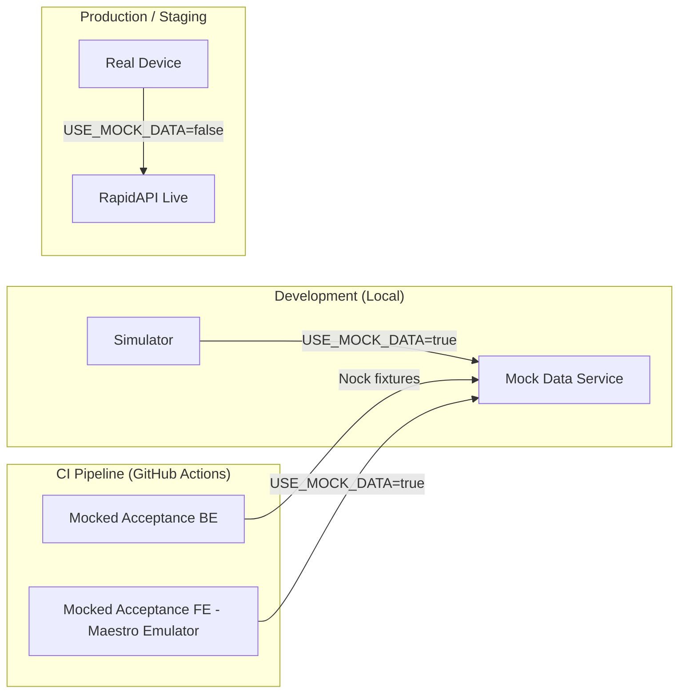
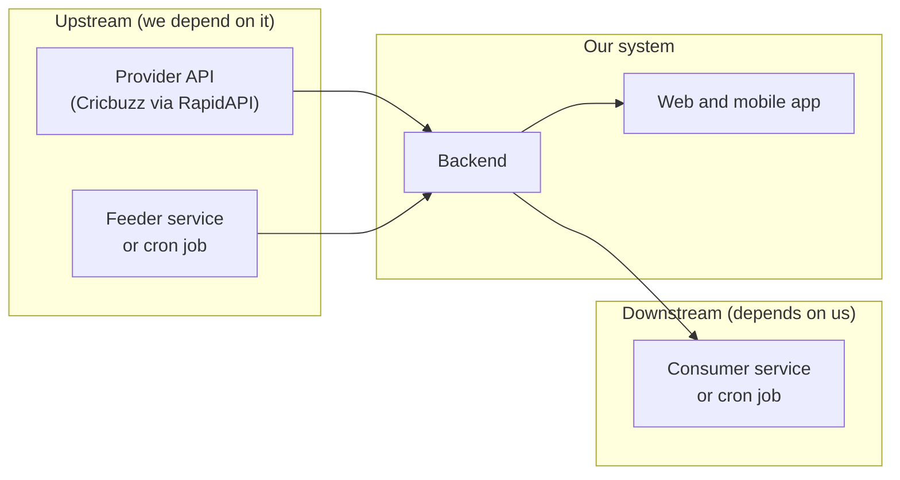

# ScoreBook Test Strategy

This page turns the [testing philosophy](./overview.md#testing-philosophy) into an operating model: for every layer of the pyramid, what it covers, when it runs, who owns it, what runs it, and what "good" looks like. Why we chose each tool is covered in the decision matrix on that layer's page under [Testing Layers](/testing/layers).

## Layers at a glance

| Layer | Description | When it runs | Owner | Tool / framework | What good looks like (run time) |
| :--- | :--- | :--- | :--- | :--- | :--- |
| [**Static: compilation & lint**](./layers/static-checks.md#compilation--lint) | Code compiles and follows our style and correctness rules, with zero warnings allowed. | **CI**: every PR and push to `main`. Also locally before commit. | DEV | ESLint, TypeScript (`tsc --noEmit`) for mobile and backend | **< 1 min**. Zero errors, zero warnings. |
| [**Static: code quality & security analysis**](./layers/static-checks.md#code-quality--security-analysis) | Quality gate on new code: bugs, security vulnerabilities and hotspots, and maintainability (code smells, duplication). | **CI**: every PR and push to `main`. | DEV (Test owns the gate thresholds) | SonarCloud | **< 5 min**. Gate passes: 0 new bugs or vulnerabilities, all hotspots reviewed, A ratings for reliability, security and maintainability, ≤ 3% duplication. |
| [**Static: AI code review**](./layers/static-checks.md#ai-code-review) | Automated AI review of the PR diff that flags logic errors, missed edge cases and risky changes. It adds to human review and doesn't replace it. | **CI**: on PR open and on every update. | DEV (author resolves, reviewer confirms) | Gitar | **First feedback < 10 min** after push. Every comment resolved or explicitly dismissed before merge. |
| [**Unit**](./layers/unit-testing.md) | Functions, hooks and components tested in isolation, with all dependencies mocked. | **CI**: every PR. Also locally in watch mode. | DEV | Jest; React Native Testing Library (frontend); coverage reported to SonarCloud | **< 2 min** for the full suite, each test in milliseconds, 0 flaky tests. **≥ 80% line coverage on new code** (enforced in the SonarCloud gate). |
| [**Mocked acceptance (FE)**](./layers/frontend-acceptance.md) | The real app (Android build on an emulator, web build in a browser) driven through user journeys against the backend in mock mode (`USE_MOCK_DATA=true`). | **CI**: smoke flows on every PR touching mobile or backend. **Schedule**: full flow suite nightly. | Test (DEV adds flows for new screens) | Maestro (mobile), Playwright (web) | **PR smoke < 15 min. Nightly full suite < 30 min.** Flake rate < 2%. |
| [**Mocked acceptance (BE)**](./layers/backend-acceptance.md) | The real HTTP API exercised in-process with third-party providers stubbed. Covers routing, validation, data transformation and error handling (4xx, 5xx, 429). | **CI**: every PR. | Test (DEV contributes) | Jest, Supertest, Nock | **< 3 min**. Deterministic, with no network calls. |
| [**Contract**](./layers/contract-testing.md) | Consumer-driven contract between mobile and backend, verified before every backend deploy. Third-party provider responses are checked against our schemas. | **CI**: every PR and push to `main` (Pact verify and `can-i-deploy` gate; provider schema tests). **Schedule**: third-party drift check daily. | DEV | Pact and Pactflow; Jest with Zod schemas; drift-check script | **< 5 min** per PR. Drift job **< 2 min**. |
| [**Integrated E2E**](./layers/integrated-e2e.md) | The full stack with no mocks: the app against the deployed backend and live providers, plus live API checks against the hosted backend. | **Schedule**: live API tests every 6 h; nightly and release-tag E2E; real devices before a store release. | Test | Maestro, Playwright, Jest + Supertest (live API) | **Live API < 10 min. E2E < 30 min.** Any failure triaged within 1 business day. |

:::tip Total PR feedback
Everything that runs on a PR runs in parallel jobs. The target is **a green or red signal in under 15 minutes** from push, with the mocked FE acceptance job on the critical path.
:::

## Suites and cadence

Layers are grouped into suites by when they run.

### 🔵 PR gate (every pull request)

- **Goal**: prove the branch is safe to merge. Fast feedback, under 15 minutes.
- **Layers**: static checks (compilation & lint, code quality & security analysis, AI code review) · unit (FE and BE) with coverage gate · mocked acceptance (BE) · mocked acceptance (FE) smoke flows on the Android emulator · contract (Pact verify, `can-i-deploy`, third-party schema tests) · for backend changes, the web app built against the candidate backend (advisory, see [Candidate API check](./layers/integrated-e2e.md#candidate-api-check-before-a-backend-change-deploys)).
- **Trigger**: pull request opened or updated.

### 🟣 Nightly regression (scheduled)

- **Goal**: catch regressions in deeper features and edge cases that are too slow for every PR.
- **Layers**: mocked acceptance (FE) full suite (all Maestro flows, the full Playwright suite across browsers and viewports) · integrated E2E against the deployed backend.
- **Trigger**: nightly schedule, and on merge to `main`.

### 🟠 Continuous monitoring (scheduled)

- **Goal**: detect breakage we don't cause ourselves, such as provider outages, quota exhaustion or upstream response-shape drift.
- **Layers**: integrated E2E live API tests (every 6 h) · third-party contract drift check (daily).
- **Trigger**: cron schedule, plus manual dispatch.

### 🟢 Release (pre-production)

- **Goal**: final sign-off before an App Store or Play Store release.
- **Layers**: integrated E2E with Maestro on **real devices** (cloud device farm or local device), covering performance and native behaviour that emulators miss.
- **Trigger**: release tag or manual dispatch.

## Quality gates

| Blocks merge or deploy | Advisory (doesn't block) |
| :--- | :--- |
| Lint and type-check errors | AI code review comments (they must be addressed or dismissed, but the reviewer makes the call) |
| Code quality gate failure (SonarCloud), including unit coverage below 80% on new code | Scheduled-job failures (nightly, live API, drift): these open an issue and notify the owner rather than blocking unrelated PRs |
| Any failing unit or mocked acceptance test | |
| Pact verification failure or `can-i-deploy` saying no | |

A flaky test is treated as a failing test. Quarantine it with a linked issue, fix it within the sprint, and never just retry it until it passes.

## Environment strategy

Mocked layers always run against committed fixtures, so results are deterministic and free. Only the integrated E2E layer touches live providers and spends RapidAPI quota. See [Test Data](./test-data.md) for the data modes.

## Integration testing of upstream and downstream systems

The [candidate API check](./layers/integrated-e2e.md#candidate-api-check-before-a-backend-change-deploys) isn't specific to our backend. It's a method that works for any neighbouring **service** or **cron job**, in either direction, as long as the two sides can be pointed at each other by configuration.

### The method

One side is the **candidate**: the system whose change is being tested, running somewhere that isn't production yet (a preview deployment, or an instance started on the CI runner). The other side is the **counterpart**, built or started from its own branch and pointed at the candidate. An agreed suite runs through the counterpart, and the result gates the candidate's change before it deploys.

| Whose change | Candidate | Counterpart (built or started from its branch) | Suite | Gate on |
| :--- | :--- | :--- | :--- | :--- |
| **Upstream** service or cron job (feeds us) | The upstream's candidate URL | Our backend and web app, with the dependency's base URL set to the candidate | The same Playwright specs we run against the hosted site, plus backend tests for the data path | The upstream's PR, via a workflow that takes the candidate URL |
| **Downstream** service or cron job (consumes us) | Their candidate, calling our API | Our backend from `main`, in mock mode on the runner (or the stable environment) | The consumer's own journey tests, plus its Pact consumer tests | Their PR, with `can-i-deploy` against our deployed version |
| **Our backend** (the case built so far) | The backend preview or a mock-mode instance | The web app from the branch | `tests/live` through the `integration` target | Backend PRs (advisory today) |

The suite is owned by **Test**. The team that owns the candidate runs it on their own PR and owns making the candidate testable (see the entry criteria below). For the implementation, see [Candidate API check](./layers/integrated-e2e.md#candidate-api-check-before-a-backend-change-deploys).

### Testing a neighbouring system

This is the sequence QA/QE follow when a service or cron job is added, or a change to one is proposed.

#### 1. Map the seam

Before writing tests, record each integration in a map: its direction, its type (service or cron job), what crosses the boundary (endpoints, fields, schedule, side effects) and which user-visible journeys depend on it. The map is the test basis. Every assertion in the suite should trace back to a row, and every change request is assessed against it.

| Neighbour | Direction | Type | What crosses the boundary | Journeys that depend on it |
| :--- | :--- | :--- | :--- | :--- |
| Cricbuzz via RapidAPI | Upstream | Service | Match lists and details, mapped to our `Match` shape | Cricket live, upcoming and completed lists |
| Match regeneration (`/api/matches/regenerate`) | Internal | Cron job | Rewrites the simulated match data daily | Every sport's lists, in simulation mode |
| Web and mobile app | Downstream | Service | Reads `GET /api/matches/:sport` and `/api/match/:id` | All sport screens |

#### 2. Choose the depth from the risk of the change

| Change to the neighbour | What to run |
| :--- | :--- |
| A field is removed, renamed or changes type | The full candidate check and contract verification. Treat as breaking: it needs a coordinated change or a versioned API. |
| A field or endpoint is added | Contract verification and a quick candidate run. Add a spec only if a journey will use it. |
| Behaviour or timing changes (rate limits, caching, cron schedule, latency) | The candidate check, an on-demand cron trigger, and a check of the monitoring suites afterwards. |
| Authentication or secrets change | The candidate check with the new credentials, in a non-production environment first. |
| No interface change (internal refactor) | The candidate check as a regression pass. |

#### 3. Decide the scope of the integration test

A neighbouring system is only tested with the integration in place: the counterpart running against the candidate. Our own unit and mocked tests don't count as testing the neighbour, because they never touch it. So scope the integration test from the map in step 1:

- **One or more tests per row of the map.** Each journey that depends on the neighbour gets a test that goes through the real integration.
- **Happy path first.** The agreed data comes back and the UI renders it.
- **Add the error responses the candidate documents and its test environment can produce**, such as the 404 for an unknown sport.
- **Leave out failures you can't trigger on demand**, such as outages and rate limiting. The scheduled live suites and the drift check watch for those once the change is deployed.

#### 4. Add the tests

1. **Start from a row of the map** and decide which journey it protects.
2. **Put the spec in `tests/live/`.** The same specs run against the hosted site and against a candidate, so a new test is written once. Use the `ScoreBookApp` page object in `tests/support/app.ts` rather than raw selectors.
3. **Assert on structure, never on values.** Candidate and live data changes between runs, so check the status code, the response envelope, the required fields and that the UI renders what the API returned. Don't assert on scores, names or counts.
4. **Check for silent failures.** Assert there are no uncaught page errors and no failed requests while the app loads.
5. **Keep the footprint small.** Prefer one page load per sport with a step per status, because every load spends the candidate's capacity (and RapidAPI quota when it isn't in mock mode).
6. **Confirm the target guard still covers the new test.** `tests/live/api-target.spec.ts` fails if any request goes to an origin other than the candidate. Without it, a mis-set URL falls back to production and the run passes against the wrong system.
7. **Run it three ways before merging:** against a local mock-mode backend (`npm run test:e2e:web:integration`), against a candidate you've deliberately broken to confirm it fails, and against the hosted site.

#### 5. Agree entry and exit criteria

The upstream or downstream service belongs to a different team. That team runs the integration check on its own PR, so the criteria are agreed with them up front and written down for each neighbour in the map.

**Entry: what the owning team provides**

- a reachable candidate (a preview URL, or a mock-mode instance that starts on the runner) with a health endpoint
- a way to point the other side at the candidate by configuration, defaulting to production when unset
- non-production credentials, such as a test `CRON_SECRET`
- a short note of what changed, which sets the depth in step 2
- a PR check that calls the integration workflow with the candidate URL and reports back on the PR

**Exit: what their PR check must show**

- every integration spec passes, including the target guard
- contract verification passes (`can-i-deploy` says yes)
- nothing fails that passed on the last green run of `main`
- any skipped or quarantined spec has a linked issue

#### 6. Run and triage

The candidate's change is the only difference from the last green run, so it's the first suspect. Use the symptom to decide who acts:

| Symptom | Likely cause | Action |
| :--- | :--- | :--- |
| Health check fails | Candidate down, protected by deployment protection, or the wrong URL | Environment problem. The owning team fixes the candidate. |
| Target guard fails | The counterpart wasn't built against the candidate, or a stale build was reused | Test setup problem. Fix the build configuration and rerun. The candidate is not at fault. |
| A shape assertion fails (for example `response has a data array`) | The candidate changed the contract | The owning team reworks the change, or agrees a versioned or coordinated change with the consumers. |
| The API response is fine but the UI is wrong | The counterpart mishandles valid data | Defect in the consumer. Raise it against the front end. |
| Passes on the PR but fails in a scheduled run | Upstream drift or provider outage | Monitoring problem. Goes to the owner of the monitoring suite, not the owning team's PR. |

A flaky result is a failing result: no retries on the PR gate. Quarantine the spec with a linked issue and fix it within the sprint, as in [Quality gates](#quality-gates).

#### 7. Keep the suite current

Test owns the map and the specs. When a neighbour adds a field, journey or schedule, update the map and the specs in the same PR. Review the map when a new provider is added or a service is retired, and make the check required (by removing the `paths` filter, because a skipped path-filtered check stays pending and blocks the merge) once it has proved stable.

### Cron jobs

A cron job has no URL to call, so the method needs three additions:

- **Trigger it on demand.** Never wait for the schedule. On Vercel a cron job is an HTTP route (ours is `/api/matches/regenerate`), so the test calls it on the candidate directly, with the candidate's own `CRON_SECRET` as a bearer token. A job that isn't an HTTP route needs a manual-run entry point, such as a workflow input or script.
- **Assert on its effects, not its exit code.** After the run, check what the job was supposed to change through the same public API the other side uses. For regeneration, that is the matches endpoints returning fresh, well-formed data for every sport and status.
- **Isolate its data.** A candidate job writes to a mock-mode or throwaway store, never to the production database. Check that the job is safe to run twice (idempotent), since a manual trigger and the schedule can overlap.

Test the schedule itself separately and cheaply. A unit-level check that every `crons[].path` in `vercel.json` matches a real route catches a renamed endpoint that would otherwise silently stop running.

### Upstream and downstream together

These checks complement the existing layers rather than replace them:

| Question | Answered by |
| :--- | :--- |
| Do the two sides agree on the shape of the messages? | [Contract tests](./layers/contract-testing.md) (Pact for consumers, Zod schemas for providers) |
| Does the real behaviour work end to end with the candidate? | The candidate check described here |
| Has the upstream changed without telling us? | The daily third-party drift check |
| Is the deployed system healthy right now? | The scheduled live suites (continuous monitoring) |
