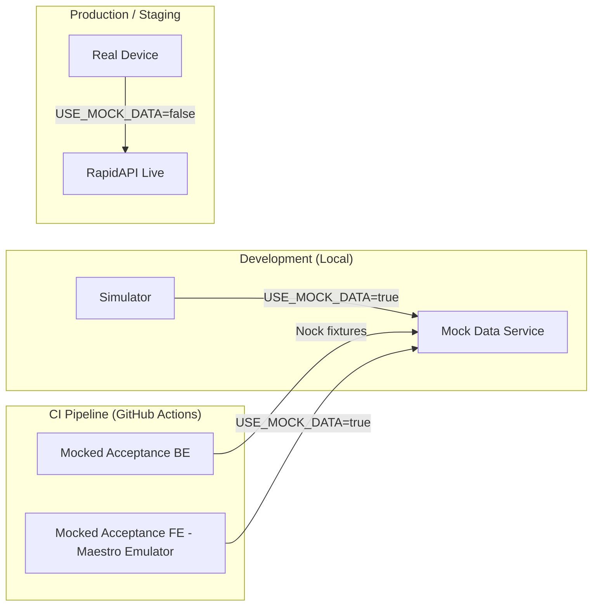

# ScoreBook Test Strategy

This page turns the [testing philosophy](./overview.md#testing-philosophy) into an operating model: for every layer of the pyramid, what it covers, when it runs, who owns it, what runs it, and what "good" looks like. Why we chose each tool is covered in the decision matrix on that layer's page under [Testing Layers](/testing/layers).

## Layers at a glance

| Layer | Description | When it runs | Owner | Tool / framework | What good looks like (run time) |
| :--- | :--- | :--- | :--- | :--- | :--- |
| [**Static: compilation & lint**](./layers/static-checks.md#compilation--lint) | Code compiles and follows our style and correctness rules, with zero warnings allowed. | **CI**: every PR and push to `main`. Also locally before commit. | DEV | ESLint, TypeScript (`tsc --noEmit`) for mobile and backend | **< 1 min**. Zero errors, zero warnings. |
| [**Static: code quality & security analysis**](./layers/static-checks.md#code-quality--security-analysis) | Quality gate on new code: bugs, security vulnerabilities and hotspots, and maintainability (code smells, duplication). | **CI**: every PR and push to `main`. | DEV (Test owns the gate thresholds) | SonarCloud | **< 5 min**. Gate passes: 0 new bugs or vulnerabilities, all hotspots reviewed, A ratings for reliability, security and maintainability, ≤ 3% duplication. |
| [**Static: AI code review**](./layers/static-checks.md#ai-code-review) | Automated AI review of the PR diff that flags logic errors, missed edge cases and risky changes. It adds to human review and doesn't replace it. | **CI**: on PR open and on every update. | DEV (author resolves, reviewer confirms) | Gitar | **First feedback < 10 min** after push. Every comment resolved or explicitly dismissed before merge. |
| [**Unit**](./layers/unit-testing.md) | Functions, hooks and components tested in isolation, with all dependencies mocked. | **CI**: every PR. Also locally in watch mode. | DEV | Jest; React Native Testing Library (frontend); coverage reported to SonarCloud | **< 2 min** for the full suite, each test in milliseconds, 0 flaky tests. **≥ 80% line coverage on new code** (enforced in the SonarCloud gate). |
| [**Mocked acceptance (FE)**](./layers/frontend-acceptance.md) | The real app (Android build on an emulator, web build in a browser) driven through user journeys against the backend in mock mode (`USE_MOCK_DATA=true`). | **CI**: smoke flows on every PR touching mobile or backend. **Schedule**: full flow suite nightly. | Test (DEV adds flows for new screens) | Maestro (mobile), Playwright (web) | **PR smoke < 15 min. Nightly full suite < 30 min.** Flake rate < 2%. |
| [**Mocked acceptance (BE)**](./layers/backend-acceptance.md) | The real HTTP API exercised in-process with third-party providers stubbed. Covers routing, validation, data transformation and error handling (4xx, 5xx, 429). | **CI**: every PR. | Test (DEV contributes) | Jest, Supertest, Nock | **< 3 min**. Deterministic, with no network calls. |
| [**Contract**](./layers/contract-testing.md) | Consumer-driven contract between mobile and backend, verified before every backend deploy. Third-party provider responses are checked against our schemas. | **CI**: every PR and push to `main` (Pact verify and `can-i-deploy` gate; provider schema tests). **Schedule**: third-party drift check daily. | DEV | Pact and Pactflow; Jest with Zod schemas; drift-check script | **< 5 min** per PR. Drift job **< 2 min**. |
| [**Integrated E2E**](./layers/integrated-e2e.md) | The full stack with no mocks: the app against the deployed backend and live providers, plus live API checks against the hosted backend. | **Schedule**: live API tests every 6 h; nightly and release-tag E2E; real devices before a store release. | Test | Maestro, Playwright, Jest + Supertest (live API) | **Live API < 10 min. E2E < 30 min.** Any failure triaged within 1 business day. |

:::tip Total PR feedback
Everything that runs on a PR runs in parallel jobs. The target is **a green or red signal in under 15 minutes** from push, with the mocked FE acceptance job on the critical path.
:::

## Suites and cadence

Layers are grouped into suites by when they run.

### 🔵 PR gate (every pull request)

- **Goal**: prove the branch is safe to merge. Fast feedback, under 15 minutes.
- **Layers**: static checks (compilation & lint, code quality & security analysis, AI code review) · unit (FE and BE) with coverage gate · mocked acceptance (BE) · mocked acceptance (FE) smoke flows on the Android emulator · contract (Pact verify, `can-i-deploy`, third-party schema tests).
- **Trigger**: pull request opened or updated.

### 🟣 Nightly regression (scheduled)

- **Goal**: catch regressions in deeper features and edge cases that are too slow for every PR.
- **Layers**: mocked acceptance (FE) full suite (all Maestro flows, the full Playwright suite across browsers and viewports) · integrated E2E against the deployed backend.
- **Trigger**: nightly schedule, and on merge to `main`.

### 🟠 Continuous monitoring (scheduled)

- **Goal**: detect breakage we don't cause ourselves, such as provider outages, quota exhaustion or upstream response-shape drift.
- **Layers**: integrated E2E live API tests (every 6 h) · third-party contract drift check (daily).
- **Trigger**: cron schedule, plus manual dispatch.

### 🟢 Release (pre-production)

- **Goal**: final sign-off before an App Store or Play Store release.
- **Layers**: integrated E2E with Maestro on **real devices** (cloud device farm or local device), covering performance and native behaviour that emulators miss.
- **Trigger**: release tag or manual dispatch.

## Quality gates

| Blocks merge or deploy | Advisory (doesn't block) |
| :--- | :--- |
| Lint and type-check errors | AI code review comments (they must be addressed or dismissed, but the reviewer makes the call) |
| Code quality gate failure (SonarCloud), including unit coverage below 80% on new code | Scheduled-job failures (nightly, live API, drift): these open an issue and notify the owner rather than blocking unrelated PRs |
| Any failing unit or mocked acceptance test | |
| Pact verification failure or `can-i-deploy` saying no | |

A flaky test is treated as a failing test. Quarantine it with a linked issue, fix it within the sprint, and never just retry it until it passes.

## Environment strategy

Mocked layers always run against committed fixtures, so results are deterministic and free. Only the integrated E2E layer touches live providers and spends RapidAPI quota. See [Test Data](./test-data.md) for the data modes.

## Current status and gaps

This strategy describes the target state. Here is where each layer stands today, based on the workflows in `.github/workflows/`:

| Layer | Status | Notes |
| :--- | :--- | :--- |
| Static: compilation & lint | 🟡 Partial | `tsc --noEmit` runs in `ci.yml`. `npm run lint` falls back to `echo 'Linting skipped'` when ESLint isn't configured, so lint doesn't actually gate anything yet. |
| Static: code quality & security analysis | 🔴 Not set up | No `sonar-project.properties` and no scan job. |
| Static: AI code review | 🔴 Not set up | The Gitar GitHub app isn't installed on the repo. |
| Unit | 🟡 Partial | Coverage isn't measured in CI or gated. FE has a single component test (`MatchCard.test.tsx`). BE has no isolated unit tests: everything goes through Supertest. |
| Mocked acceptance (FE) | 🟡 Partial | Maestro smoke runs on PRs (`maestro.yml`). Playwright has only a placeholder smoke spec and isn't in CI. There's no nightly full suite. |
| Mocked acceptance (BE) | 🟢 In place | `test/integration/*` runs on every PR in `ci.yml`. |
| Contract | 🟢 In place | Pact publish, verify, `can-i-deploy` and record-deployment in `contract-tests.yml`. Cricbuzz schema tests run on PRs, with a daily drift check. Other providers aren't covered yet. |
| Integrated E2E | 🟡 Partial | Live API tests every 6 h (`live-api-tests.yml`). No app-level E2E against the deployed backend, and no real-device runs. |
